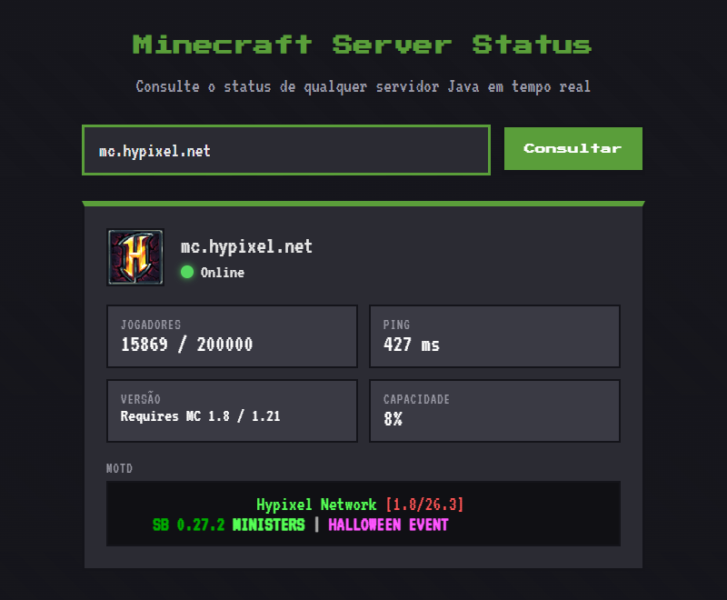

# Minecraft Server Status

Painel web para consultar o status de qualquer servidor de Minecraft (Java Edition) em tempo real. Digite o endereço do servidor e veja se está online, quantos jogadores estão conectados, a versão, o MOTD, o ping e o ícone — tudo com uma interface em tema pixelado.

<!-- Dica: tire um print da tela com um servidor consultado e coloque aqui -->
<!--  -->

**Demo:** _(adicione o link do deploy aqui depois de publicar no Render)_

## Como funciona

O Minecraft tem um protocolo próprio chamado **Server List Ping** — é o mesmo que o launcher do jogo usa para mostrar o status na lista de servidores. O backend faz esse "aperto de mão" com o servidor informado e traduz a resposta para um JSON limpo, que o front-end usa para desenhar o painel.

```
Navegador  ->  GET /api/status?host=mc.exemplo.net  ->  FastAPI
                                                          |
                                    Server List Ping (mcstatus)
                                                          |
                                             Servidor de Minecraft
```

## Tecnologias

- **Python** + **FastAPI** — backend e API
- **mcstatus** — consulta ao servidor via protocolo Server List Ping
- **HTML / CSS / JavaScript** (sem framework) — interface
- **Render** — deploy

## Rodando localmente

Requer Python 3.10 ou superior.

```bash
# 1. Crie e ative um ambiente virtual
python -m venv .venv
source .venv/bin/activate      # Windows: .venv\Scripts\activate

# 2. Instale as dependências
pip install -r requirements.txt

# 3. Suba o servidor
uvicorn app.main:app --reload
```

Abra `http://localhost:8000` no navegador.

## API

### `GET /api/status?host={endereço}`

Consulta o status de um servidor. O endereço pode incluir a porta (ex: `meuserver.com:25566`); sem porta, usa a padrão `25565`.

**Exemplo de resposta (online):**

```json
{
  "online": true,
  "host": "mc.exemplo.net",
  "jogadores_online": 42,
  "jogadores_max": 100,
  "versao": "1.21.4",
  "motd": "Bem-vindo ao servidor!",
  "ping_ms": 38,
  "icone": "data:image/png;base64,...",
  "amostra_jogadores": ["Steve", "Alex"]
}
```

Quando o servidor está offline ou inacessível, a resposta vem com `"online": false` e um campo `"erro"`.

## Estrutura

```
minecraft-server-status/
├── app/
│   ├── main.py    # rotas da API e da interface
│   └── mc.py      # consulta ao servidor de Minecraft
├── static/        # front-end (HTML, CSS, JS)
├── requirements.txt
└── render.yaml    # configuração de deploy
```

---

Projeto pessoal de estudo. Não é afiliado à Mojang Studios nem à Microsoft.
